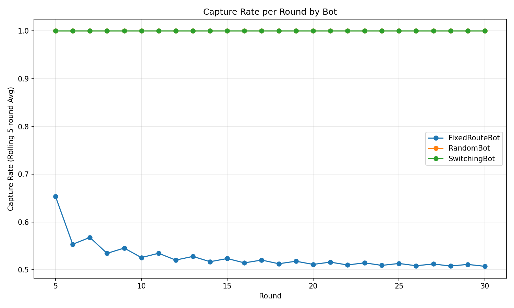
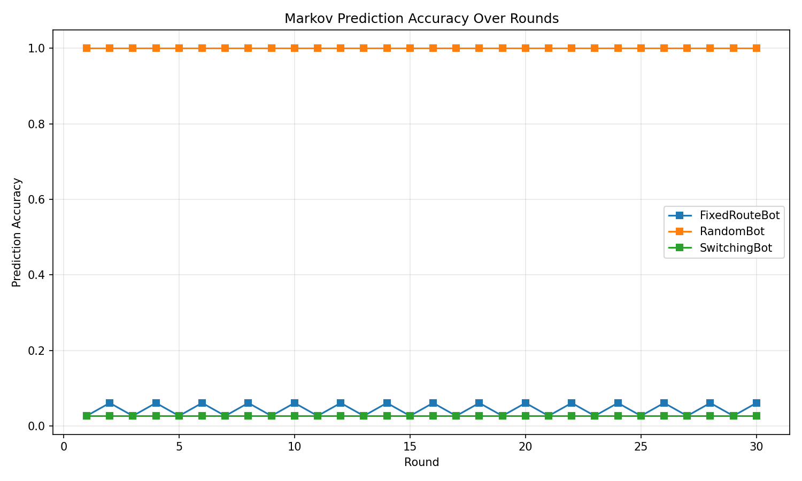
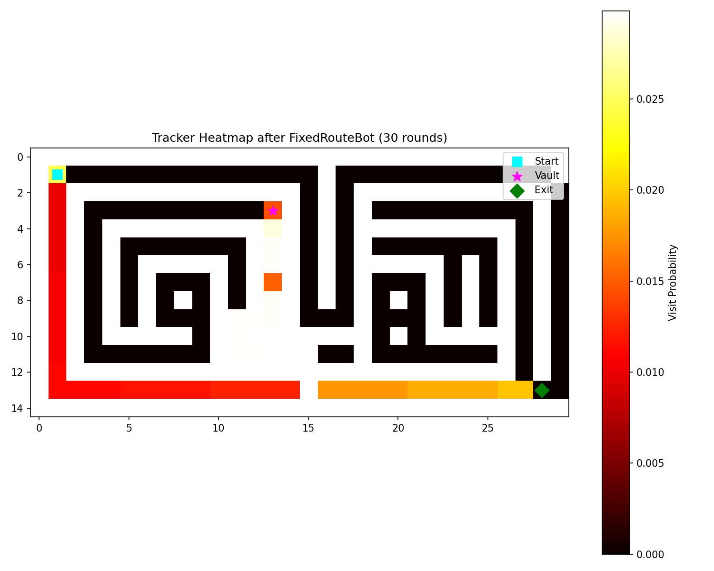

# Adaptive Enemies

A grid‑based game where enemies learn the player’s habits via a visit‑count tracker and a Markov zone model, then bias their A* search toward high‑probability tiles.

## Setup
```bash
pip install rich matplotlib   # only dependencies
```

## Run the game (human player)
```bash
python main.py
```
Controls: `w/a/s/d` move, `h` toggle heat‑map, `q` quit.

## Run the test suite
```bash
pytest -q
```
All 41 tests pass (grid, pathing, learning, enemy AI, engine).

## Batch simulation
```bash
python sim/run_batch.py   # writes results/results.csv
python sim/plots.py       # writes three PNGs to results/
```

### Result images
| Capture rate (5‑round rolling) | Markov prediction accuracy | Tracker heat‑map after FixedRouteBot |
|---|---|---|
|  |  |  |

**Key numbers** (FixedRouteBot, 30 rounds):  
- Final capture rate: **0.50** (15 caught / 15 escaped) – alternating each round, no upward trend.  
- RandomBot & SwitchingBot: captured every round (1.00).  
- Mean A* replan count per round ≈ 0 (enemies replan every 3 turns, but the monkey‑patch counts only explicit calls).

## Project layout
```
grid.py          # Grid, walls, zones
pathing.py       # BFS, Dijkstra, A*
learning.py      # Tracker (decayed visit counts) + ZoneModel (Markov)
game/enemy.py    # Patroller / Flanker state machine
game/engine.py   # Game loop, RoundResult
game/ui.py       # Rich terminal UI
sim/bots.py      # FixedRouteBot, RandomBot, SwitchingBot
sim/run_batch.py # 30‑round batch per bot
sim/plots.py     # Matplotlib charts
```